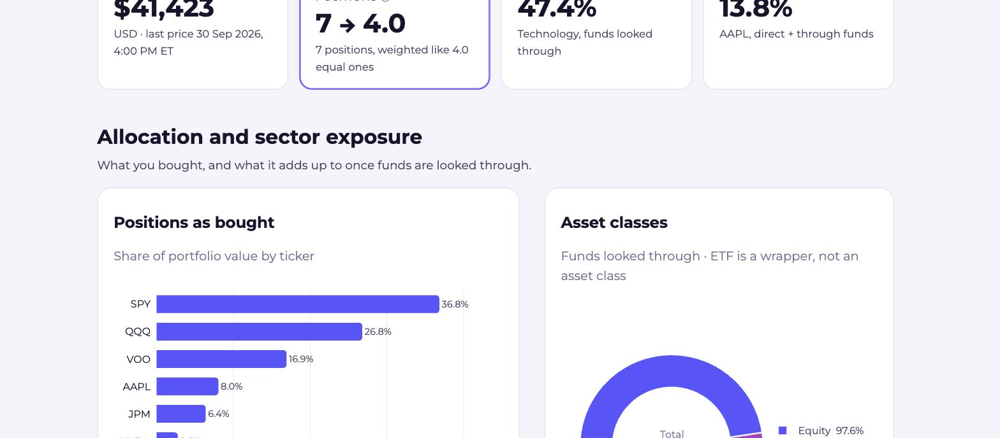
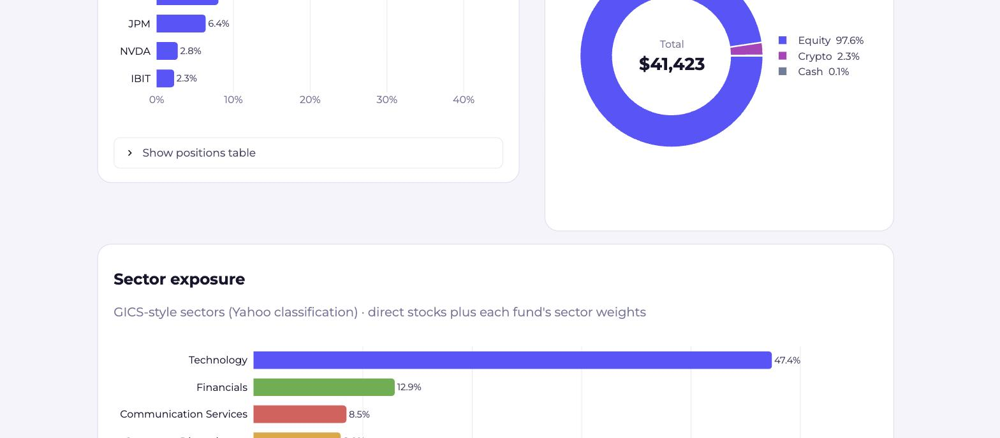

# How's My Portfolio?

By **Gianni Chepote** · [GitHub](https://github.com/gianni-chepote)

**What are you actually exposed to?** Seven tickers rarely mean seven
independent bets. SPY and VOO hold the same 500 companies, QQQ adds more of
the same tech names, and a direct AAPL position stacks on top of the AAPL
inside every fund. This app looks through the funds and shows the exposure
underneath.

**Live app:** https://hows-my-portfolio.streamlit.app



## What it shows

Enter tickers and share counts (US stocks and ETFs, long only, USD). The page
then shows, top to bottom:

1. **Headline cards:** portfolio value, tickers vs. *effective* positions,
   largest sector, and largest single company.
2. **Allocation:** positions as bought, and asset classes once funds are
   looked through. An ETF is a wrapper, not an asset class.
3. **Sector exposure:** the 11 GICS-style sectors, combining direct stocks
   with each fund's sector weights. Crypto, cash, and unknown amounts keep
   their own bars rather than vanishing.
4. **Underlying companies:** the largest companies held directly plus through
   funds, and which funds hold each one.
5. **Correlation heatmaps:** one for the holdings and one for the sectors you
   hold, with the most correlated pairs.
6. **Summary:** a short, templated description built from the same numbers.



The page follows the system's light or dark setting.

## Method

- **Look-through.** A fund at 20% of the portfolio with 40% in Technology adds
  8 percentage points to Technology. A fund's value is never added on top of
  its constituents, so every view sums to 100%.
- **Effective positions** = 1 / Σ wᵢ², the inverse Herfindahl index of
  position weights. Equal weights give the ticker count; one dominant
  position pulls it towards 1.
- **Company look-through** uses each fund's top 10 disclosed holdings, the
  limit of the free data. The undisclosed remainder is labelled "other
  holdings" and never rescaled to 100%; the page states the coverage.
- **Sectors** come from Yahoo's classification, mapped to GICS-style labels.
  Each fund's sector weights apply to its equity sleeve only; fund cash goes
  to the cash bucket.
- **Correlations** use daily simple returns on adjusted closes over the past
  year: Pearson, one common date window, no forward-filling. Series with fewer
  than 60 overlapping returns are left out and listed. Sector correlations use
  the SPDR sector ETFs (XLK, XLF, …) as proxies.
- **Prices** are the last available from Yahoo Finance, not live quotes.

The app describes exposure. It does not forecast or recommend trades.

## Limits

- Free data lists only each fund's top 10 holdings.
- Leveraged and inverse funds (TQQQ, SQQQ, …) are flagged and left out:
  their exposure resets daily through derivatives, which look-through cannot
  represent.
- Fund-of-funds are not unpacked further.

Invalid tickers, missing prices, short histories, and a Yahoo outage each
produce a visible message rather than an error page.

## Run locally

```bash
python -m venv .venv
source .venv/bin/activate
pip install -r requirements-dev.txt
streamlit run streamlit_app.py
```

`HMP_DATA=fixtures streamlit run streamlit_app.py` runs on the frozen data
snapshot in `fixtures/`, with no network calls. `pytest` runs the test suite
offline against the same snapshot.

## Layout

```text
streamlit_app.py      page layout only
portfolio/
  data.py             input parsing, Yahoo fetch, normalisation
  exposure.py         weights, asset classes, sectors, companies
  correlation.py      return correlations and ranked pairs
  summary.py          templated summary text
  charts.py, theme.py Plotly figures and the light/dark theme
fixtures/             frozen data snapshot for tests
tests/                engine tests and app smoke tests
```

Built with Streamlit, Plotly, pandas, and yfinance.
